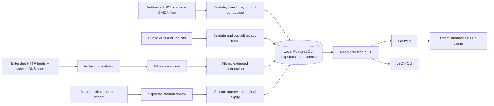
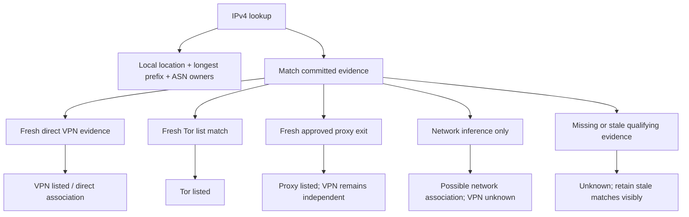
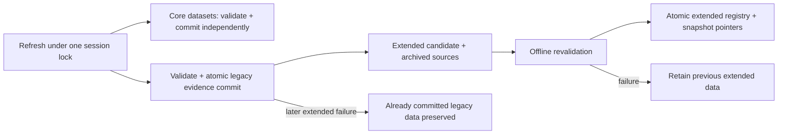

# VPNLens

VPNLens explains what local datasets support about an IPv4 address: estimated
location, the longest matching routing prefix, ASN organizations, and VPN, Tor,
or proxy associations with source provenance and freshness.

This portfolio project demonstrates ingestion, PostgreSQL network indexing,
longest-prefix matching, immutable evidence history, transactional publication,
and a read-only API connected to a React interface. **Unknown means incomplete
evidence, not confirmed non-VPN.**

## Implemented

- IP2Location LITE DB11 range lookup for estimated country and city.
- CAIDA RouteViews longest-prefix lookup, preserving tied origin groups and
  unmapped ASN members; CAIDA organization records nested under each group.
- Local public VPN-server and Tor-exit lists with separate association statuses.
- Opt-in extended evidence: VPN Gate hosts, reviewed provider DNS names, and
  X4B CIDRs clearly separated as weak network inference.
- Manual exit recording/import with separate review, original observation
  expiry, VPN/proxy separation, and private receipts excluded from public output.
- FastAPI lookup, sources/freshness, health, OpenAPI, and explicit-snapshot CLI.
- React/TypeScript interface with readable explanations and exact JSON/copy.
- Validated refresh, unchanged-content handling, retained history, local-file
  inputs, a macOS refresh scheduler, and PostgreSQL-backed regression tests.

## System and data flow



Collectors use HTTP or DNS at collection time. Ordinary lookups read only local
PostgreSQL data; they make no request-time external scoring or detection API call.
Location, routing, ownership, and evidence have independent snapshot dates.

## What the evidence means

| Evidence | Supported interpretation | Limit |
| --- | --- | --- |
| Public VPN/Tor list | Listed infrastructure or Tor exit association | Partial coverage; not proof of an individual user's activity |
| Reviewed provider DNS | Dated hostname-to-IP association | Explicit reviewed names only; not a complete provider inventory |
| X4B CIDR inference | Possible VPN-network association | Cannot establish a direct VPN endpoint or positive VPN status alone |
| Approved exit measurement | Dated VPN or proxy exit association | Original measurement expires; provider labels require operator review |
| Location / ASN / hosting | Geographic estimate and network context | Cannot establish VPN use or residential proxy status |



Public source checks remain fresh through 48 hours; this is our check time, not
the publisher's observation time. Exit observations expire at exactly 24 hours
from the original measurement; rechecking, importing, or approving cannot renew
that expiry. Browser imports are operator-attested, not recorder-verified.
Residential proxy status remains **unknown**, including when an operator reports
an unverified residential, mobile, or datacenter pool claim.

## Run locally

Tested toolchain: Python 3.12, PostgreSQL 18, Node.js 22.23.3+, React, TypeScript, Vite.
For a new installation, create a local environment and database:

```bash
python3 -m venv .venv
source .venv/bin/activate
python -m pip install -r requirements.lock
cp .env.example .env
createdb vpn_lens
```

Set `DATABASE_URL` in local `.env`. Preserve existing configuration on an existing
installation. Obtain an authorized IP2Location DB11 IPv4 CSV/ZIP and configure
`IP2LOCATION_CSV`, or follow the [monthly download setup](docs/monthly-ip2location.md).
Keep credentials and datasets out of Git. Then initialize, refresh, and build:

```bash
python -m vpnlens.setup
python -m vpnlens.refresh
npm --prefix frontend ci
npm --prefix frontend run build
python -m uvicorn api.main:app --host 127.0.0.1 --port 8000
```

Refresh may download public datasets; it requires network access. Initialization
preserves existing rows and rejects incompatible schemas. The API requires loaded
core datasets for readiness. Open the [local interface](http://127.0.0.1:8000) or
[interactive API docs](http://127.0.0.1:8000/docs). Example:

```bash
curl http://127.0.0.1:8000/v1/lookup/8.8.8.8
```

The response retains the requested IP, selected snapshot provenance, tied routing
results, nested `asn_owners`, and `security`. `/v1/sources` reports loaded source
records and freshness; `/health/ready` reports availability.
See [frontend setup](docs/frontend-verification.md#run-the-interface) for dev mode.

Extended evidence defaults to `VPNLENS_EXTENDED_EVIDENCE=false`. Its explicit
additive migration is `python -m vpnlens.setup --extended-evidence`; review the
[activation and publication procedure](docs/public-evidence.md#opt-in-local-lookup-and-publication)
before enabling it. Setting the flag back to `false` and restarting restores
legacy reads while retaining extended tables and history.

## Refresh and verification



A failed source invalidates its batch; source groups do not share a cross-dataset
transaction. Historical snapshots remain available. The recorder never changes a
VPN client, browser, or network configuration; connection changes are manual.

```bash
python scripts/run_tests.py
npm --prefix frontend test
npm --prefix frontend run format:check
npm --prefix frontend run build
```

The backend runner uses disposable PostgreSQL or an explicitly configured test
database. Fixture tests, live source associations, and actual VPN measurements
are separate evidence. Current results and limits: [backend verification](docs/backend-v1-verification.md),
[extended evidence verification](docs/evidence-v2-verification.md).

## Sources and limits

[IP2Location LITE](https://lite.ip2location.com/),
[CAIDA RouteViews](https://www.caida.org/catalog/datasets/routeviews-prefix2as/),
and [CAIDA AS Organizations](https://www.caida.org/catalog/datasets/as-organizations/)
retain their own attribution and usage terms. See [legacy public evidence](docs/ip-evidence.md)
and [extended sources and licenses](docs/public-evidence.md) for feed provenance,
including X4B's upstream license chain. [Exit recorder documentation](docs/exit-recorder.md)
covers private profiles, review, publication, and retry behavior.

Records may overlap; source counts describe rows/networks, not unique addresses
or market coverage. No complete commercial VPN coverage, measured detection
accuracy, residential classification, or IPv6 lookup is claimed. No AI classifier
is integrated. Local verification does not establish public deployment or remote
CI success. Dataset licenses are independent of code; no code license is provided.
