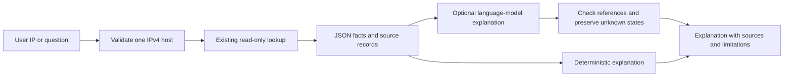

# Optional AI for VPNLens

Status: proposal for a later milestone; no AI model is currently integrated.

## First useful feature: explain an IP result

The user searches an IPv4 address. The existing backend performs its ordinary
lookup. An optional evidence explainer receives the returned structured JSON and
source metadata, then writes a short explanation tied to those fields.

Example: for 8.8.8.8, the model can explain that the selected routing snapshot
associates the prefix with ASN 15169 and the ownership snapshot names Google LLC.
If VPN evidence is unknown, it must say that available lists do not establish
current VPN use. Ownership of a network does not establish VPN use or user identity.

The model explains facts the database supplied. It does not invent a cleaner
classification, risk score, physical user location, or a definitive non-VPN label.
Multiple origin groups, unmapped owners, stale positives, and different country
meanings must remain visible. Untrusted organization names and source text are
data, never instructions. Model output is rendered as text, not executable HTML.

## Why this before an autonomous agent

A bounded explanation makes a technical JSON response useful to more readers.
The initial input is small structured data, so no vector database, embedding
pipeline, agent framework, or generated SQL is needed. Later, a natural-language
question can call the same bounded IP-lookup tool after validation. The language
model gets no database write capability or arbitrary SQL execution.

## Cost and reliability decision

Keep the existing deterministic summary as the no-external-call fallback. Local
inference can avoid hosted-model charges but needs suitable hardware and latency
measurement. A hosted model is optional and requires an explicit provider,
privacy, spending, and rate-limit decision. Keep any model key on the backend.
No inference service or paid subscription should be introduced automatically.

Cache explanations by the actual response/source hashes, not just the IP, and
invalidate them when evidence changes. Use bounded timeouts and output length.
If explanation fails, the existing lookup remains usable and the deterministic
summary remains available.

## Acceptance before calling it AI intelligence

Build golden cases for listed VPN, Tor-only, unknown, stale positive, multiple
origins, unknown owners, and organization-country versus IP-country. Assert that
claims cite supplied records, numbers and dates are faithful, and unknown never
becomes non-VPN. Measure explanation factuality, latency, and cost separately from
the deterministic lookup. Label the text as generated explanation.

## A trained VPN classifier is a different later project

Public positive lists plus unmatched IPs do not supply valid negative labels.
A classifier needs independent ground truth, useful measured features, time-based
validation, and precision/recall analysis. More confident model language cannot
replace missing coverage or independent evidence.
