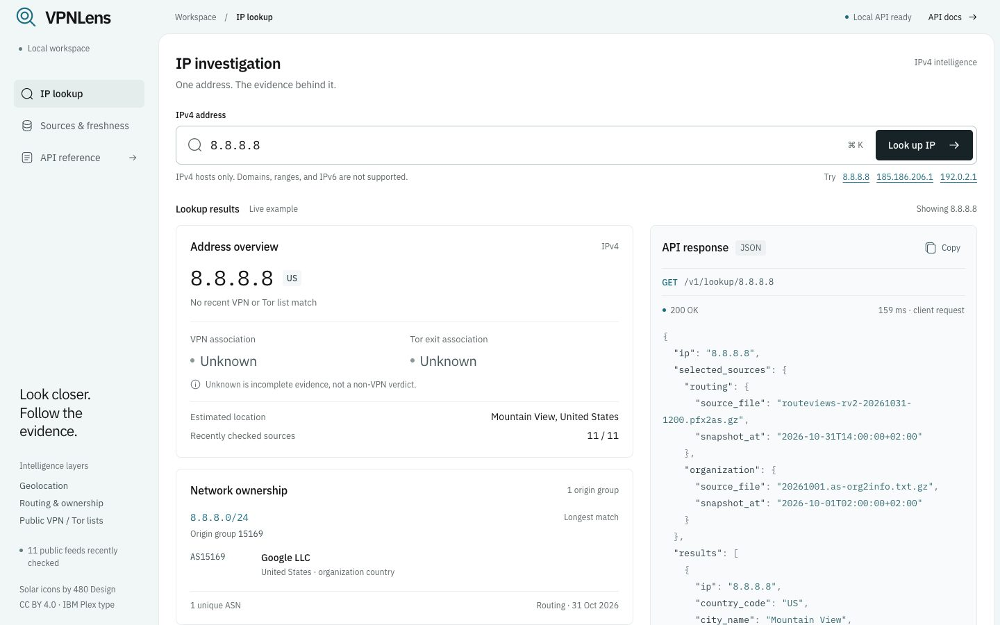
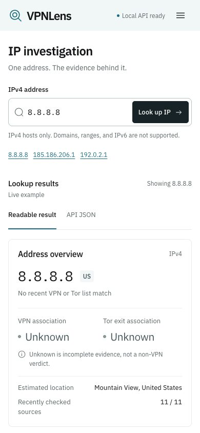
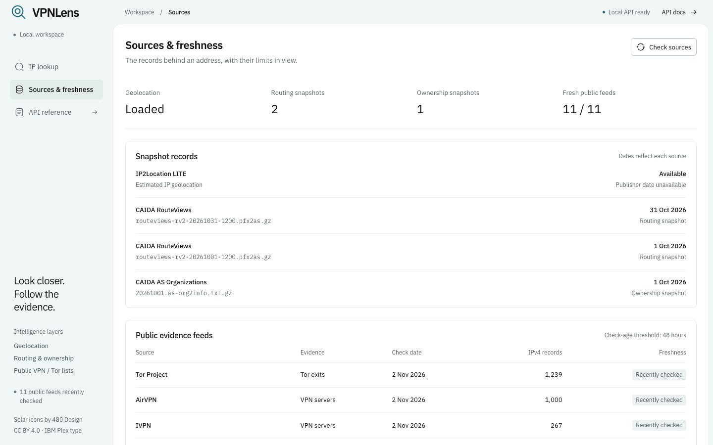

# Connected frontend verification

Verified locally on 2026-11-02 in `/Users/nishankbansal/Documents/VPNLens`.
The approved design is implemented; final user review remains pending.
No commit, GitHub push, public deployment, or AI inference was performed.

## Run the interface

From the project root, using Node 22 and the configured Python environment:

```bash
npm --prefix frontend ci
npm --prefix frontend run build
.venv/bin/python -m uvicorn api.main:app --host 127.0.0.1 --port 8000
```

Open <http://127.0.0.1:8000>. API docs remain at `/docs`. Build before starting
FastAPI: it only registers the frontend routes if `frontend/dist/index.html`
exists at startup. If the API predates the first build, restart that process.
The backend still runs when the frontend is absent.

For frontend development, leave FastAPI running and use:

```bash
npm --prefix frontend run dev
```

Vite serves <http://127.0.0.1:5173> and proxies `/v1`, `/health`, `/docs`, and
`/openapi.json` to the local backend. Production uses same-origin requests.
No provider token or database configuration is placed in frontend assets.

## Changed responsibilities

| Files | Purpose |
| --- | --- |
| `frontend/src/App.tsx`, `api.ts`, `types.ts` | Search/navigation state, bounded relative requests, cancellation, validation, API contracts |
| `frontend/src/components/` and `presentation.ts` | Readable results, nested owners, evidence, exact returned JSON object/copy, source metadata |
| `frontend/src/styles.css`, `icons.tsx`, `main.tsx`, `useMotion.ts` | Responsive framed sheet, local assets, scoped motion and cleanup |
| `frontend/tests/` | Input/data/error behavior and controlled motion lifecycle tests |
| `api/main.py` | Serve only the built root document and `/assets`; retain API routing and errors |
| `tests/test_backend_api.py` | Static-serving presence/absence and API/path boundaries |
| `.github/workflows/tests.yml` | Frontend format/test/build alongside existing backend CI |
| `README.md`, this report, visual review, AI roadmap | Setup, architecture, actual verification and later proposals |

Core SQL, schemas, and refresh behavior were not changed for this frontend milestone.
Existing uncommitted backend work was preserved.

## Automated results

| Check | Actual result |
| --- | --- |
| `npm --prefix frontend test` | 30 passed: 25 API/presentation tests plus 5 controlled DOM motion tests |
| `npm --prefix frontend run format:check` | Passed |
| `npm --prefix frontend run build` | Passed TypeScript and Vite production build |
| `.venv/bin/python scripts/run_tests.py` | 93 backend tests passed in disposable PostgreSQL |
| Ruff, backend CI scope | Passed |
| Ruff, entire repository | 12 existing import/unused-import issues outside this frontend change |
| `git diff --check` | Passed |
| App inspector, Lookup | 0 FAIL / 0 WARN at 1440, 768, 390 |
| App inspector, Sources | 0 FAIL / 0 WARN at 1440, 768, 390 |
| Design source lint | 0 FAIL / 1 intentional WARN: monospace IPv4 input |

Each inspector run produced six fold/full-page screenshot sheets. All 12 final
screenshots were opened and reviewed. [Visual critique](frontend-design-review.md)
records three rounds and a subjective final weighted score of 7.84/10.
GitHub Actions was configured, but remote CI has not run for these changes.
The broader `ruff check --no-cache .` found 12 import/unused-import issues in
existing ingestion, practice, lookup, and test files. They were not changed for
this frontend milestone; a repository-wide clean lint result is not claimed.

Reproduce code checks:

```bash
npm --prefix frontend test
npm --prefix frontend run format:check
npm --prefix frontend run build
.venv/bin/python scripts/run_tests.py
.venv/bin/python -m ruff check --no-cache api vpnlens scripts tests/test_backend_api.py tests/test_refresh_workflow.py tests/test_refresh_schedule.py tests/backend_support.py tests/test_ip2location_auto.py
git diff --check
```

The backend runner uses a temporary local cluster or a dedicated
`VPNLENS_TEST_DATABASE_URL`; it does not use the normal `.env` database as a test fallback.

## Real local browser checks

These observations came from the real local FastAPI service and loaded snapshots.
They describe this verification date, not permanent IP classifications.

| Search/action | Observed result |
| --- | --- |
| `8.8.8.8` | US / Mountain View, `8.8.8.0/24`, ASN 15169 / Google LLC, VPN and Tor unknown |
| `185.186.206.1` | OM / Muscat; both longest-prefix origin groups retained; three owner rows, two unique ASNs |
| `1.220.90.178` | Public VPN list match; Tor unknown |
| `2.56.10.36` | Tor exit list match; VPN unknown |
| `192.0.2.1` | No routing origin; VPN and Tor unknown |
| Invalid `::1` | Focus and field error; no new lookup; previous result remains labelled with its own IP |
| Enter search and example controls | New real result and corresponding JSON |
| Copy | Visible clipboard-success feedback; clipboard contents were not read back |
| Phone tabs | Arrow navigation selects/focuses API JSON and shows it |
| Phone Sources/menu | Navigation, source metadata refresh, internal table scroll; no global horizontal overflow |
| Skip link on Sources | Focus moves to main; Sources view/hash stays unchanged |
| Final Sources reload | Current production bundle; no new warning/error console entries |

## Controlled checks and their limits

- API-unavailable UI: a temporary local fixture returned 503. Error/retry appeared,
  no result was invented, and copy stayed disabled.
- Stale evidence UI: a temporary fixture supplied explicitly stale test evidence.
  The stale match remained visible while current VPN/Tor states remained unknown.
  This is UI behavior proof, not a real stale-provider observation.
- Reduced motion: five controlled DOM tests verify preference bypass, Lenis scope,
  ticker time conversion, preference changes, and resource cleanup. Native Chrome
  reduced-motion emulation was unavailable; no such browser run is claimed.
- No JavaScript: the compiled HTML was parsed with scripting disabled. Its
  `noscript` explanation, schema link, sample JSON link, and docs link were verified.
  This is static DOM proof, not a JavaScript-disabled Chrome screenshot.
- The temporary fixture services are test-only and are stopped after verification.

## Design and assets

Framed-sheet/light, seed `20261102`, chosen from the dealt directions without a
redraw. The lookup asks what the available evidence says about one IP. Sources
asks which records are loaded and how recently they were checked. The signature
is the visible source-to-finding trace beside the exact returned JSON object.

IBM Plex Sans/Mono fonts are locally bundled under SIL OFL 1.1. Solar icons by
480 Design use CC BY 4.0; attribution appears in the desktop sidebar and
[asset provenance](../frontend/ASSETS.md). The lens mark is original. No photographs,
avatars, purchased media, reference screenshots, or invented customer content ship.
The live result workspace is the focal asset; default 8.8.8.8 is labelled a live
example and is fetched from our API, with no mock fallback to replace before use.

GSAP provides brief result feedback. Lenis is the only smooth-scroll engine and
runs only on Sources, keeping lookup/code interaction native. Reduced motion
bypasses these effects. Three.js was omitted because this API has no spatial
visualization data. [AI](ai-roadmap.md) remains a separate proposal.

## Remaining limits

Local-only, IPv4-only, partial public VPN/Tor coverage. Unknown is insufficient
evidence, never a confirmed non-VPN result. Dates/check age do not guarantee
current upstream observations. Organization country and estimated IP location
remain distinct. No proxy label, score, accuracy percentage, user-location claim,
AI classifier, paid service, or public hosting was added.

The source table needs horizontal scrolling on a phone. Production serving needs
a successful build before startup. Remote CI and broader real-browser/device
coverage remain unverified. Final code/product approval remains with the user.

## Captured interface

Public sample data captured on 2026-11-02:






