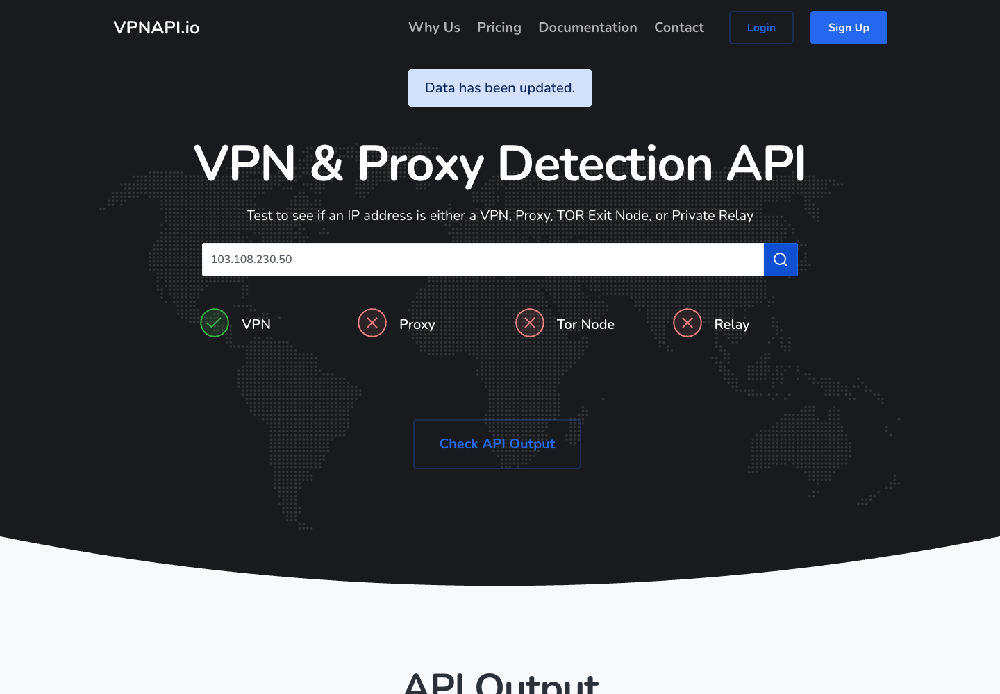

# VPNAPI.io detection investigation

Investigated on 2026-11-02. This is a research report and implementation proposal,
not an approved implementation design or a claim to have recovered VPNAPI's
private classifier. No product code, schema, lookup data, or scheduler changed.
Nothing was committed or pushed.

## Questions and result

| Question | Result | Evidence type |
| --- | --- | --- |
| Does the public lookup label 103.108.230.50 as VPN and residential proxy? | Reproduced: both true | Controlled browser observation |
| Does frontend JavaScript calculate those labels? | The inspected lookup handler sends the IP to the server and renders returned values | Delivered asset plus observed request/response |
| Does the provider-detail response expose the reason? | It returns labels again, without provider identity or detection method in this response | Selected /widget-pro response |
| Why did the private classifier choose residential_proxy for this IP? | Unresolved; its dataset, rules, evidence row and thresholds are not exposed | Explicit investigation boundary |
| Can VPNLens implement a similar collection architecture? | Yes, as a proposed general collector and evidence system | Engineering proposal |
| Can we establish coverage of most VPNs or matching commercial accuracy? | Not from this investigation; representative independent evaluation is required | Explicit coverage limit |

## Direct observations

A temporary Chromium profile opened the public homepage, filled the IP field,
clicked its search control and waited for JSON containing 103.108.230.50.
The returned object reproduced the user's sample: vpn true, residential_proxy
true, proxy false, Tor false and relay false. Routing described AS136557,
Host Universal Pty Ltd and 103.108.230.0/24, with JP geolocation.
See [sanitized response](vpnapi-103.108.230.50-observation.json).

The homepage's delivered dynamic.js binds lookup to get_a, whose POST /widget
response is rendered into the JSON element and passed to the result display.
The selected lookup request-67 returned HTTP 200. Its captured JSON agreed with
the rendered DOM. The subsequent /result-3 request renders the result display;
it does not reveal the server's classification rules.

The public VPN detector page additionally made POST /widget-pro for the selected
IP. That response also returned vpn true and residential_proxy true, without a
provider name, underlying observation, features, score or explanation. See the
[provider-detail observation](vpnapi-103.108.230.50-provider-observation.json).
The page-level JSON assertion timed out in this second scenario; its network
response is usable evidence, while a successful final DOM/screenshot is not claimed.

These observations locate the classification result on the server side of the
inspected lookup boundary. They do not establish whether the backend queries a
local database, calls another vendor, uses observations, applies heuristics,
retains old records, or combines these methods for this specific IP.

## What the vendors disclose

[VPNAPI's own FAQ](https://vpnapi.io/) describes collecting network/range/history
information, subscribing to VPN services, connecting to VPN servers, obtaining
other datasets, and working with ISPs. These are vendor statements, not an
independent audit of their data pipeline or claimed accuracy.
Its [proxy page](https://vpnapi.io/proxy-detection) additionally describes public
and private proxy lists, open-proxy-port checks and expiry. It offers residential
detection but does not publish its residential classification rules. The meaning
of proxy false together with residential_proxy true remains vendor-specific and
is not explained by its public API documentation.

A separate vendor, [IPinfo](https://ipinfo.io/blog/residential-proxy-detection-fraud),
explicitly describes connecting through proxy services as a registered customer,
then recording observed exit IPs, service names and dates. This is a concrete
measurement pattern we could reproduce on services we can access. It is not
proof that VPNAPI uses the same private method.
[Spur](https://docs.spur.us/knowledgebase/faqs/how-does-spur-detect-vpns-residential-proxies-and-isp-proxies)
describes combining routing/infrastructure, observed relaying activity over time
and research into services. Its classifications are scoped to observations and
time windows, rather than ownership alone.

Service association and connection type require separate interpretation.
[IPinfo's API documentation](https://ipinfo.io/developers/residential-proxy-api)
explicitly distinguishes residential, mobile and datacenter pools within its
proxy product. This is IPinfo's terminology, not an established definition of
VPNAPI's field.

## Why UrbanVPN association does not settle residential classification

The user confirms using UrbanVPN. Prior investigation also found a Netify
UrbanVPN association and an A-record mapping for p-jp1.urban-vpn.com to this IP.
Those observations support a service association, not proof of consumer-broadband
infrastructure or relaying activity at a particular time.

UrbanVPN's official publications are inconsistent: its current English
[P2P glossary](https://www.urban-vpn.com/glossary/peer-to-peer/) denies operating
as a P2P network, while its localized
[French why-free page](https://www.urban-vpn.com/fr/about-us/why-free/)
describes community resource sharing. This investigation did not resolve which
text reflects current deployed architecture. A rule that marks every UrbanVPN
IP as residential would therefore be unsupported.

The IP's AU organization country and JP geolocation cannot establish proxy use.
Likewise, a datacenter ASN or a hostname association is insufficient alone.
One plausible explanation for the vendor result is a stored provider/pool
association. Other possibilities include direct observed proxy activity, an
imported classification or stale/error data. These are hypotheses, not recovered
rules or verified explanations for this IP.

## Practical build approaches

Both approaches retain local database lookups, no paid detection API, and no
frontend redesign in this milestone. Architecture, core schema/SQL, evidence
policy and final review remain user-owned.

1. **Public-source engine first.** Reuse existing refresh orchestration, add
   reviewed source definitions and parsers for provider host lists, CIDR feeds,
   and provider hostname/config sources. This scales collection beyond a single
   provider, but discovery remains bounded by available public sources.
2. **Public sources plus an exit recorder (recommended).** Add a separate way to
   record public exit observations from authorized VPN/proxy sessions, including
   provider/server, observation time, destination receipt and original evidence
   identity. This supplies stronger activity evidence for tested services. It
   requires access to those services and an appropriate Internet-visible receiver
   or equivalent reviewed measurement path. No receiver was deployed and no VPN
   session was started during this investigation.

An exit observation establishes use through a service for that measurement. It
still does not automatically prove the exit is a residential connection. A
residential label requires a reviewed evidence rule and credible connection-type
support; unknown remains available when those requirements are not satisfied.

Current code supports only exact IPv4 hosts, two indicator categories and one
provider per source snapshot. Ranges, per-record providers, hostname provenance,
entrance/exit role and evidence strength require a reviewed contract change before
implementation. Snapshot check time and actual service-observation time must stay
separate. Multiple mirrors of one upstream must not count as independent proof.

Candidate public sources include the existing
[provider-published server aggregator](https://github.com/Joe12387/open-source-vpn-ip-lists),
[X4B VPN ranges](https://github.com/X4BNet/lists_vpn), and the official
[VPN Gate server list/CSV](https://www.vpngate.net/en/).
The aggregator warns about incomplete coverage and differing entrance/exit pools.
X4B's ranges include ASN/manual/keyword-derived inference and possible hosting
overlap. VPN Gate covers its own volunteer servers, not other providers.
Source-specific license/attribution, schema and freshness checks belong in source
onboarding. These candidates were researched, not ingested in this milestone.

Acceptance for the eventual implementation should include the UrbanVPN example
and several other providers, source-backed explanations, stale/missing behavior,
separate weak network inference, and preservation of unrelated hosting traffic.
Use held-out time periods/providers and measured sessions for independent
validation. Feed imports cannot also serve as independent ground truth. Report
actual bounded sample coverage; do not invent an accuracy percentage or claim
coverage of most VPNs before measurement.

## REA evidence ledger and boundaries

- Initial page capture:
  ev_217f5f5c9fddb2d26af376f8323cb632c5aff92013d88911f322604e4aa79633.
  Page structure and script/handler discovery only. Its 50-transaction budget
  omitted later events; no complete traffic coverage is claimed.
- Successful selected-IP homepage scenario:
  ev_2e9226f55528db5da91367edc17e78de2910139b5110ea19dcb356db9af4fa79.
  All declared actions completed; selected request-67 body and final JSON DOM
  agree. Other selected network bodies were unavailable, so the tool marked the
  overall events section incomplete. Response.body() bytes may be decoded or
  reloaded by the browser; this is API-response evidence, not a wire capture or
  request-initiator stack.
- Selected /widget-pro scenario:
  ev_8a7baf9aafdae9eee0fcfdbfa022563cbfd1a52d370d782971e5f58d1192559e.
  Target response request-51 was captured. Final JSON wait failed and the next
  screenshot action was cancelled. No successful final page capture is claimed.
- Static application analysis parent:
  ev_3d48737e7a58a6d0bed5d7eb828f40494a86eab262bad87ef6c7a45fbc3776fb.
  Summary view: ev_4aa03a458cbe58b827754c44592e09d43d07a5cf1da4d9c418cd807c788736fa.
  Only delivered dynamic.js was analyzed. It parsed without errors, but the
  semantic graph retains 539 unknowns, including dynamic jQuery calls/properties.
  No full static reconstruction or backend source recovery is claimed.
- dynamic.js: 17,369 bytes; SHA-256
  8dab00ee31982c1e377b0d1672e84ebd926adb0e1ed9e2cfb4cda8b264477f7c.
  [Public delivered asset](https://vpnapi.io/assets/js/dynamic.js).
  Relevant file lines: get_a POST at 175-181, JSON rendering at 209 and result
  display at 214; provider-detail POST at 300-302 and label forwarding at 312.
- Selected /widget response body SHA-256:
  3ca3756cc0ddbb762f8fd0320b467cda25997bb54be1d5e79a321e1839c82661.
- Selected /widget-pro response body SHA-256:
  3c35e839ea5099d3e1997882573573e8c2b2397eb03c6d5225e5c8d8303825bd.
- Browser profiles were temporary and REA confirmed their owned processes were
  terminated. No native binary session was opened. No client credential or
  session-token values are copied into these repository artifacts. Raw capture
  material remains in a private temporary research bundle, not repository data.

This report answers the public behavior and collection-method questions, and
explicitly leaves the private residential rule and commercial coverage unresolved.
It does not mark the original detection gap fixed.

