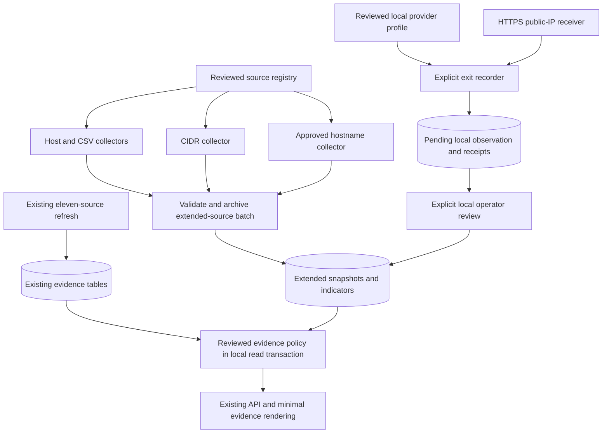

# VPNLens: public evidence expansion and exit recorder

Date: 2026-11-02
Status: Approved by the user on 2026-11-02 after builder check and import-policy clarification. Implementation is planned; product code is not yet changed.
Plan: [execution index](../plans/2026-11-02-vpn-evidence-expansion.md).
Implementation has not started. This document does not authorize public deployment,
paid subscriptions, automatic VPN control, Git commits, or a GitHub push.

## Intent and decisions already made

The user wants broad automatic collection across VPN providers, rather than a
special case for UrbanVPN. They selected **public sources plus an exit recorder**
over a public-source-only implementation. Budget remains zero for paid datasets
and detection APIs. Existing IP searches should use the local database.

The triggering address, 103.108.230.50, is absent from the current ten-provider
VPN feeds. User confirmation, a public UrbanVPN hostname association and a
third-party classification support an UrbanVPN association. VPNAPI's public
lookup also returns residential_proxy true, but its private rule and evidence
were not recovered. See the [investigation](../../research/2026-11-02-vpnapi-detection.md).
We must not invent that residential label to make one example pass.

The user retains architecture, data modeling, core SQL, failure-policy decisions
and final review. The architecture, contracts, defaults and failure rules below
are builder proposals for their approval. Final DDL and core lookup logic remain
a user-owned attempt/review checkpoint; no replacement SQL is supplied here.

## Approaches considered

1. **Public sources alone:** lower setup cost, broader published infrastructure
   coverage, but cannot produce independent exit observations for services that
   omit their servers or rotate residential pools. Not selected as the full scope.
2. **Public sources plus exit recorder:** selected by the user. Add direct
   transport observations from services they can access while keeping provider
   identity and network-type claims explicit. More setup and manual operation,
   stronger evidence for tested paths, still incomplete coverage.
3. A paid detection API or licensed full database was rejected by the established
   budget/local-lookup constraint. Copying another service's booleans and treating
   hosting ASNs or organization-country mismatches as VPN proof do not meet the
   evidence requirement.

## Goals and stop condition

Deliver a reusable backend extension that:

- Collects approved host-IP, CIDR, CSV and provider-hostname evidence with shared
  parsers and source definitions. Adding a provider to an existing format should
  require source/profile data rather than a provider-specific Python branch.
- Retains exact source, provider where known, evidence method, record/role,
  hashes, observation/check times and expiry.
- Distinguishes direct service association, broad network inference, measured
  exits and operator-supplied claims.
- Records public exit measurements for accessible VPN/proxy sessions through
  an explicit CLI, with no automatic connection changes.
- Enriches the existing API and current interface only enough to explain these
  facts and their uncertainty. No visual redesign or new dashboard.
- Proves behavior with disposable database tests and separately documented live
  source/recorder checks. Reports bounded measured coverage, not an invented
  accuracy score or a claim to detect all/most VPNs.

Stop after those collectors, recorder, API/evidence rendering, migration, tests
and documentation pass review. No machine-learning classifier, global network
scanning, browser extension, automated fleet of VPN clients, new public server,
IPv6 lookup, residential-data subscription or general proxy crawler.

Residential-proxy truth is a separate evidence requirement. This milestone adds
an explicit unknown status and preserves any reported pool/connection-type claim
as attributed metadata. It does **not** enable a positive residential flag from
UrbanVPN branding, a DNS match, country differences or ASN membership. A future
positive rule needs independently reviewed residential/relay evidence and user
approval; current fixtures must not be presented as real coverage.

## Current implementation and reuse

The active project is /Users/nishankbansal/Documents/VPNLens, main, with existing
uncommitted backend/frontend work that must be preserved.

- ingestion/ip_evidence.py handles eleven fixed source files, one provider per
  snapshot, host-IP text, exact IPv4 matches and a 48-hour successful-check age.
- sql/ip_evidence_schema.sql accepts /32 INET values and vpn_server/tor_exit.
- All eleven legacy sources validate before one atomic evidence publication.
- vpnlens.refresh holds its existing full-refresh lock and commits independent
  datasets; a later failure preserves earlier committed datasets.
- Lookup uses a read-only repeatable-read transaction. No network calls occur
  during lookup. The API selects independent routing/organization snapshots.
- Security exposes vpn_status and tor_status as listed/unknown. The frontend
  currently validates these literals and the two legacy indicator types.
- The existing daily full-refresh LaunchAgent remains the only scheduled job.

Keep geolocation/routing/organization SQL and refresh semantics unchanged. Retain
legacy tables/loaders and old response fields for compatibility and rollback.

## Proposed collection architecture

The recorder makes collection-time network requests. Ordinary IP lookup remains
fully local. No new Internet-visible server is deployed by this milestone.

## Initial source registry and onboarding

Keep the current ten provider files and Tor feed unchanged. Additional initial
sources are a separate extended group:

| Source | Adapter | Interpretation |
| --- | --- | --- |
| X4B output/vpn/ipv4.txt | IPv4 CIDR | VPN-network inference, never measured exit or residential proof |
| VPN Gate official CSV | CSV host column | Listed VPN endpoint association; volunteer operator is not inferred from provider branding |
| Reviewed provider hostname manifest | DNS A | Dated provider-hostname association; initially includes the reviewed UrbanVPN hostname |

Sources:
- https://github.com/X4BNet/lists_vpn and its documented output/vpn/ipv4.txt.
  Do not ingest the datacenter output as a VPN-positive source. Preserve the
  documented license/attribution chain, including upstream database notices.
- https://www.vpngate.net/en/ links its official CSV at
  https://www.vpngate.net/api/iphone/. Parse only the needed IP/hostname fields;
  never execute decoded VPN configurations. Preserve attribution and describe
  the published list as partial, not the whole volunteer network.
- Initial hostname p-jp1.urban-vpn.com, provider UrbanVPN. Its provenance records
  the user-reviewed association and the cited public research page, rather than
  pretending it was supplied in a provider-published bulk list:
  https://www.netify.ai/resources/ips/103.108.230.50.

A source entry declares stable ID, upstream family, URL or reviewed hostname
manifest, adapter, role, evidence basis, provider mapping, attribution, enabled
state and age policy. Mirrors of one upstream share a family and do not count
as independent corroboration. Hostnames are explicit; no brute-force enumeration
or arbitrary URL execution. New formats require a reviewed adapter.

Suggested source IDs: x4b-vpn-v4, vpngate-v4, urbanvpn-dns-v4. A DNS provider entry
can contain multiple reviewed hosts; other providers use the same adapter.
The framework supports multiple providers; automatic discovery of every provider
or every hostname is not promised.

Use the existing daily scheduler. All new scheduled sources initially use the
existing 48-hour check-age convention, labelled as successful source check age,
not guaranteed current traffic. More frequent scheduling is outside this slice.

## Normalization and storage contract proposal

Use additive storage; keep the two legacy evidence tables intact. Logical
entities below define required meaning, not final table names or DDL:

1. **Extended snapshot:** UUID, source ID/family, collection method, source URL,
   content hash, fetched/check times, optional publisher time, record count,
   active status and source-policy version. Zero records are valid only for a
   successfully completed DNS withdrawal, not for an empty HTTP feed.
2. **Extended indicator:** snapshot reference, canonical IPv4 CIDR (/32 for a
   host), record key, optional provider ID/name, role (server/exit/unknown), basis
   (provider_list/provider_dns/network_inference), hostname or source-row
   reference, and method-specific metadata. Preserve overlapping sources and
   providers. Do not expand a CIDR into individual addresses.
3. **Exit observation:** immutable measurement UUID, local profile ID, transport
   method, baseline/active phases, actual observation times, observed public IP,
   receipt hashes/paths, operator attestation/review state and expiry. Provider
   identity and connection type retain their provenance; an echo receiver does
   not verify either. Approved observations participate in lookup without
   rewriting an upstream feed snapshot.

All timestamps are timezone-aware and stored in UTC. Missing publisher time,
provider, role or connection type stays null/unknown. A retrieval time never
fills in for an upstream observation time. Stable HTTP content reuses its content
snapshot and advances only successful check time. DNS bundles include their
actual query/answer timestamps and are new dated observations even if answers
repeat. Recorder observation time advances only after a new successful request.

Uniqueness must preserve identical networks from distinct providers/records.
Use snapshot plus deterministic record identity; do not collapse by IP alone.
Observations are uniquely identified by measurement UUID, with idempotent import
of an identical observation and rejection of conflicting content for that ID.
Index CIDR containment and source activity using PostgreSQL's appropriate network
operator class. The user reviews that SQL and its query plan before acceptance.

Raw files, profiles, receipts and hashes live under ignored data/evidence-v2/
and data/observations/ directories. Profiles containing credentials stay local.
Only explicitly sanitized examples enter docs/tests. Do not collect browser
cookies, browsing history or unrelated traffic.

## Extended refresh and failure-policy proposal

Retain the legacy eleven-source publication transaction. Execute the extended
sources as one additional atomic group under the existing full-refresh owner;
use a coordinated evidence publication lock for standalone writers as well.
Legacy success is not undone if the extended group later fails. Record each
group's success/error separately and return a failing command status for a failed
requested group. Geolocation/routing/organization behavior remains unchanged.

Validate all enabled extended sources before changing their active snapshots.
One malformed/failed extended source retains that group's prior active data;
failed checks do not renew its successful-check times. Successful files may
remain archived after a later failure, without becoming active. Repeated content
must not duplicate rows. Do not delete history or prune observations automatically.

- HTTP: validate status, declared length where present, bounded download,
  decoding, schema, public IPv4 values and a nonempty supported result. Reject
  catch-all /0 networks. Enforce a source-specific bounded payload cap; initial
  host/CIDR cap 5 MB and CSV cap 25 MB. Reject invalid rows rather than silently
  publishing a partial candidate.
- DNS: query only reviewed names with a bounded timeout. A successful NXDOMAIN
  or no-A answer is a withdrawal for that name. A completely resolved manifest
  can publish zero current addresses. Timeout/SERVFAIL/incomplete resolution is
  failure and retains old data without renewing it. Unsupported IPv6 is counted,
  and private/special-purpose answers are rejected. Keep DNS TTL when available,
  but never describe the 48-hour association check-age as DNS cache validity.
- Recorder: timeout, malformed/untrusted receiver JSON, TLS failure, nonpublic
  IPv4, mismatched repeated measurements or database failure creates no eligible
  positive. Preserve a bounded failure receipt without credentials. A recorder
  failure cannot deactivate public sources or renew an older observation.

Disabled extended sources are excluded from current evidence and expected-source
counts; retained historical rows do not accidentally remain active for lookup.
Source enable/disable changes apply as an explicit registry/configuration
publication. If publication fails, the last working registry remains active.
Manual recorder profiles/observations are not scheduled feeds and do not increase
health's expected-feed denominator. Missing/stale scheduled evidence degrades
source health while core lookup remains available as it does today.

## Exit recorder workflow and limitations

Use a separate CLI with local writes; add no public write endpoint or recorder
button to the existing read-only app. Command names below are a proposed contract:

1. python -m vpnlens.observe baseline --profile NAME
   The operator disconnects the relevant VPN/proxy and explicitly attests that
   this is the baseline. Store the observed public IPv4 and receipt locally.
2. The operator connects their VPN, or chooses an already configured HTTP proxy.
   VPNLens does not change network settings, install clients or log into accounts.
3. python -m vpnlens.observe capture --profile NAME --baseline ID
   Require a baseline no older than 15 minutes and two agreeing active IP
   receipts. The endpoint is https://api.ipify.org?format=json, documented at
   https://www.ipify.org/. This is a free public-IP echo dependency during
   recording only, not a paid detection API or a lookup dependency. It sees the
   collector's public IP; profile/provider labels and credentials are not sent.
4. Store a pending observation. Review its provider/profile binding and receipts,
   then publish it explicitly with python -m vpnlens.observe approve ID. A review
   records local operator identity/attestation, not independent provider proof.
5. Lookup may use a fresh approved VPN observation as a dated service association.
   Initial observation eligibility is 24 hours from actual active measurement.
   Imported or renewed check times cannot extend it. Old receipts remain history.

First-version automated transports are system_tunnel and explicit_http_proxy.
System-tunnel probes disable implicit HTTP proxy environment/config discovery so
that the measurement path is explicit; kernel-level routing still applies.
Explicit HTTP-proxy credentials come from a local secret reference, never command
arguments, logs, source URLs or database evidence fields. TLS validation remains
on. Repeated probes to one echo service are consistency checks, not two independent
sources or cryptographic proof of the provider's identity.

If active IP equals baseline, do not publish a new verified transport change.
Keep it unverified and explain that the recorder cannot distinguish a bypassed,
inactive, split tunnel or already-active baseline from that result. Never label
it non-VPN. Do not fall back to a direct request if the selected proxy fails.

Browser-only VPN extensions can bypass Python entirely. Do not silently treat a
Python probe as their exit. Provide an operator import format for dated IP-echo
receipts captured in the actual browser/profile. Such imports are explicitly
operator_attested, pending review, and are never described as recorder-verified
transport. To become lookup-eligible they must satisfy the same baseline-age,
two-agreeing-active-receipt and IP-change requirements as automated captures,
with all receipts taken through the stated browser/profile and original UTC
observation times preserved. The operator attests the baseline was disconnected
and the active phase used that profile; this is not cryptographically verified.
Incomplete, conflicting, stale or unchanged-IP imports remain archived and
ineligible. Approval cannot override these validation failures. Imports cannot
independently enable residential-proxy classification.
No browser automation, extension installation or use of personal browser storage
is included. A later browser recorder is a separate design discussion.

Profiles state provider, intended service category, transport and documentation
reference. A provider's residential product claim remains a reported pool claim,
not verified per-IP residential access. Positive residential classification is
not enabled by this milestone. HTTP-proxy observations record observed proxy
service association separately from VPN association.

## Classification and API compatibility proposal

Preserve existing fields and enum values:

- vpn_status remains listed/unknown. A fresh exact eligible provider endpoint,
  reviewed hostname association or approved VPN observation can yield listed.
  This means service association, not proof about the current requesting user.
- tor_status remains listed/unknown, with the existing Tor source behavior.
- Stale matching evidence remains visible but cannot establish a fresh positive.
- Broad CIDR/ASN-derived network evidence alone never changes vpn_status to listed.

Add additive fields:

- vpn_assessment: direct_association, network_only or unknown. network_only is
  rendered as possible VPN-network association, not confirmed VPN use. Fresh
  direct evidence takes precedence without discarding weaker supporting records.
- proxy_status: listed/unknown, based only on eligible approved proxy exit
  observations in this slice; absence is unknown.
- residential_proxy_status: unknown for this slice, with an explanatory missing-
  evidence reason. Do not expose false as a substitute for unsupported detection.
- additional_evidence: typed network inference, proxy observation and attributed
  claims, retaining method, role, source family, matched CIDR, provider, timestamps,
  expiry, approval/provenance and stale state.

Fresh strong VPN/Tor evidence also has a compatibility projection into existing
security.evidence using vpn_server/tor_exit and existing required fields. Do not
put new indicator types into that legacy array, which the current frontend
rejects. Weak network/proxy records remain in additional_evidence. Preserve old
count and stale_after_hours fields; document that 48 hours describes public-feed
check age, while observation records expose their own 24-hour expiry explicitly.

Existing origin-group rows and nested owners remain unchanged. Evaluate security
once per requested IPv4 and attach it consistently to every returned origin
row in the same read-only transaction. No country mismatch, hosting ASN,
maliciousness or physical user-location claim is inferred from a match.

Update only data types, response validation, status/evidence explanations and
source status rendering in the current frontend. Retain the chosen layout,
search, raw JSON/copy, loading/error handling and source page. No visual redesign.

## Non-destructive installation and rollback

Add an explicit versioned migration/setup extension for new tables, constraints,
indexes and registry state. It must be transactional, idempotent, validate existing
contracts and fail without destructive resets. Do not silently migrate on a
lookup request or recreate data. Legacy tables and data stay intact.

A configuration flag enables extended reads/refresh after setup and seed checks.
With it off, keep current API behavior and the legacy eleven-source refresh.
Rollback disables extended reads/refresh and leaves new data/archives for review;
it does not drop tables or rewind unrelated dataset commits. Re-enable only after
compatibility checks. The implementation plan must test both flag states and
standalone/full-refresh locking. No live database changes before fixture proof
and user review of the migration/core query.

## Verification and acceptance

Controlled checks must cover:

- Existing 93 backend and 30 frontend tests remain valid or receive narrowly
  explained contract updates; their past passes are baseline evidence only.
- Host/CIDR/CSV/DNS parsing, duplicates, private/bad inputs, CIDR boundaries,
  unchanged content, DNS withdrawals, partial failures and transaction rollback.
- Source-family correlation, disabled-source exclusion, exact versus inferred
  evidence, per-provider overlaps and existing longest-prefix origin ties.
- Expiry at and around boundaries; a successful source check never renews a
  recorder's actual observation time. Eligible unknown/missing states persist.
- Recorder route modes, no silent direct fallback, credential-safe failures,
  stale/missing/equal baselines, disagreeing receipts, pending/approved imports,
  immutable identity and idempotent/conflicting re-import behavior.
- Additive API and minimal UI handling of direct association, network_only,
  proxy observations, stale evidence and residential unknown. Preserve old clients.
- Migration/rollback against an existing fixture installation and read-only lookup
  with no network calls, locks/timeouts and evidence containment index use.

Separate live checks after implementation:

- Re-fetch enabled public sources and record actual source/indicator counts.
- Re-resolve reviewed UrbanVPN names. If 103.108.230.50 is still associated,
  lookup must show the dated UrbanVPN association and its method. If upstream
  changed, record that fact instead of hardcoding the IP as positive forever.
- Exercise at least two other available provider associations and a network-only
  case. 8.8.8.8 must not become VPN-listed merely from hosting/datacenter evidence.
- Record an authorized accessible VPN session only when the operator supplies
  access and activates it. Show the actual transport, provider attestation,
  receipt, pending/review state, lookup association and expiry.
- A fixture or manual import proves only its declared path; it is not live proof
  of a full-tunnel connection, residential status or broad commercial coverage.

Report results by source and bounded provider/time sample. Independent evaluation
must not reuse imported feeds as its ground truth. No promise of most-provider
coverage, false-positive rate or commercial parity without appropriate measurement.

## Work sequence after approval

1. Agree the user-owned logical data/API/failure contract and attempt/review the
   required core DDL/containment SQL; preserve the base IP lookup statement.
2. Implement additive fixture migration and source registry/collectors using normal
   Python/configuration/logging/tests, then run the existing backend checks.
3. Implement recorder profiles, pending receipts, review/publication and expiry.
4. Integrate local evidence evaluation/API and minimal current-interface rendering.
5. Run migration/rollback, unit/integration/build checks, then bounded approved
   live-source and recorder checks; document actual coverage and remaining gaps.
6. Final user code/product review. Commit or push only when explicitly requested.

No additional feature, paid resource or public deployment is included implicitly.

## Builder-check result

A fresh software/data-engineering reviewer raised one material ambiguity: whether
browser imports require the automatic recorder's baseline/repeat/IP-change checks.
The draft now explicitly requires all three before lookup eligibility, plus
operator review; failed validation cannot be overridden by approval. This is a
conservative builder proposal for the user's policy approval, not a decision
attributed to the user. No other important planning questions were reported.
